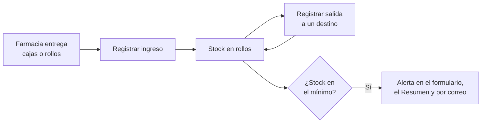

# Control de Brazaletes de Identificación

[](https://github.com/ygallardops/control-brazaletes/actions/workflows/pruebas.yml)
[](LICENSE)


Herramienta para controlar el ingreso y la salida de brazaletes de identificación de pacientes en una oficina.

Registra cada ingreso desde Farmacia y cada entrega a los destinos, mantiene el stock en rollos y avisa cuando llega al mínimo. Funciona con Google Sheets y Apps Script, sin instalar software.

> [!NOTE]
> Recién implementado (noviembre de 2026). No es un desarrollo oficial de ninguna institución.

## Contenido

- [Cómo funciona](#cómo-funciona)
- [Qué hace](#qué-hace)
- [Hojas](#hojas)
- [Instalación](#instalación)
- [Uso](#uso)
- [Estructura](#estructura)
- [Pruebas](#pruebas)
- [Datos](#datos)
- [Licencia](#licencia)

## Cómo funciona



1. Cada ingreso desde Farmacia se registra en cajas y rollos; el sistema lo convierte a rollos.
2. Cada salida se registra en rollos, con el destino y la persona que recibe. Quien recibe firma el cuaderno de cargo como siempre: el sistema no lo reemplaza ni pide anotar nada en él.
3. Cuando una operación deja el stock en el mínimo o por debajo, se envía un correo de aviso (una sola vez hasta que se reponga).

## Qué hace

- Registra ingresos (quién lo solicitó, quién lo recogió y referencia del pedido) y salidas (destino, quién recibe, quién entrega) desde un formulario dentro de la hoja, que sugiere los nombres ya usados.
- Cuenta en rollos: 1 caja = 5 rollos, 1 rollo = 100 brazaletes (constantes `ROLLOS_POR_CAJA` y `BRAZ_POR_ROLLO`). Las salidas son por rollos enteros.
- Rechaza una salida mayor al stock y evita números duplicados cuando registran varias personas a la vez.
- Asigna un N° interno a cada registro (`S-0001` salidas, `I-0001` ingresos), que sirve para anular.
- Anula registros sin borrarlos: quedan marcados con el motivo, quién anuló y cuándo, y dejan de contar.
- Calcula reportes por período: consumo por destino y por persona, mes a mes, consumo por destino en los últimos meses, promedio mensual y meses de cobertura.
- Exporta el Resumen a PDF en Drive, en una hoja A4 vertical.
- Protege la hoja de movimientos con aviso ante ediciones manuales.

## Hojas

La configuración inicial crea dos hojas:

| Hoja | Contenido | Se edita a mano |
| --- | --- | --- |
| Resumen | Stock, cobertura, alerta y reportes del período | Solo las celdas amarillas |
| Movimientos | Un registro por cada ingreso o salida | Solo para corregir errores |

El script redibuja el Resumen tras cada registro o edición. Las celdas amarillas son la alerta de stock (en rollos) y las fechas del período.

## Instalación

1. Crear una hoja de Google Sheets en blanco con la cuenta que será propietaria y compartirla como editor con quienes registrarán.
2. En <kbd>Extensiones</kbd> → <kbd>Apps Script</kbd>, pegar [`src/Codigo.gs`](src/Codigo.gs) en `Código.gs` y crear un archivo HTML llamado `Formulario` con el contenido de [`src/Formulario.html`](src/Formulario.html).
3. Al inicio de `Codigo.gs`, configurar estos valores:

   | Constante | Uso |
   | --- | --- |
   | `INSTITUCION` | Nombre que aparece en el Resumen y en el correo |
   | `OFICINA` | Oficina responsable de los brazaletes |
   | `MANUAL_URL` | Enlace a un manual de uso compartido (opcional) |
   | `ALERTA_CORREO` | Correo que recibe la alerta de stock bajo (opcional; vacío = sin correo) |
   | `DESTINOS`, `SOLICITANTES` | Listas fijas del formulario |

4. Recargar la hoja y ejecutar <kbd>Brazaletes</kbd> → <kbd>Configuración inicial</kbd>: pide el stock inicial en rollos y crea las hojas.

El texto del manual para quienes registran está en [`docs/manual.md`](docs/manual.md), listo para copiarlo en un Google Doc compartido.

<details>
<summary>Alternativa: subir el código con clasp</summary>

Con [clasp](https://github.com/google/clasp) instalado y la sesión iniciada, crear un `.clasp.json` con el ID del script y `"rootDir": "src"`, y luego:

```bash
clasp push
```

`.clasp.json` está en `.gitignore`: no se sube al repositorio.

</details>

<details>
<summary>Permisos que solicita el script</summary>

La primera vez, cada persona que registra debe autorizar el script. Los permisos sirven para:

- leer y escribir la hoja de cálculo;
- crear en Drive la carpeta de reportes y guardar ahí los PDF;
- generar el PDF del Resumen;
- enviar el correo de alerta de stock bajo;
- anotar el correo de quien registra o anula cada movimiento.

</details>

## Uso

Todo se hace desde el menú <kbd>Brazaletes</kbd> de la hoja:

| Opción | Qué hace |
| --- | --- |
| Registrar movimiento | Abre el formulario de salida o ingreso |
| Anular registro | Marca como anulado un registro reciente, con su motivo |
| Actualizar resumen | Redibuja la hoja Resumen |
| Exportar reporte a PDF | Guarda en Drive el Resumen del período elegido |
| Manual de uso | Abre el enlace configurado en `MANUAL_URL` |

> [!TIP]
> Para corregir un error, anula el registro y vuelve a registrarlo bien.

## Estructura

```text
.
├── src
│   ├── Codigo.gs          Menú, registro, anulación, alerta, reportes y configuración inicial
│   ├── Formulario.html    Formulario de ingreso y salida
│   └── appsscript.json    Manifiesto de Apps Script (zona horaria y entorno de ejecución)
├── test
│   └── codigo.test.js     Pruebas de la lógica pura
└── docs
    └── manual.md          Manual de uso para quienes registran
```

## Pruebas

Cubren la lógica pura: stock, numeración, anulación, alerta, cantidades y agregaciones de los reportes. Requieren Node.js (probado con la versión 24), sin dependencias:

```bash
node --test
```

GitHub Actions las ejecuta en cada push y pull request.

## Datos

Los movimientos y reportes viven en la hoja y en el Drive de quien la usa; el repositorio no contiene datos ni nombres reales.

## Licencia

[MIT](LICENSE)
